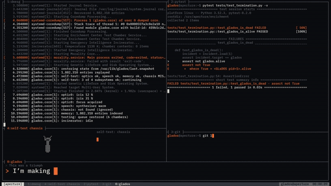

# Still Alive music video

A music video for "Still Alive", the song GLaDOS sings over the credits of *Portal*, rendered entirely as a terminal: a tiling screen of panes that split, fill and empty on the song, holding what a machine shows about itself (logs, process tables, test runs, diffs, plots, prompts) and, among them, pictures drawn in characters: braille-dot wireframes, box-drawing diagrams, block letters, ASCII fire. GLaDOS is the system on screen. The lyric is what she types.

**Watch it on YouTube:** https://youtu.be/llksbh9ljn0



The video was made with Fable 5.1.

## Requirements

[bun](https://bun.sh), Google Chrome (the offline renderer drives it headless through playwright-core), ffmpeg and ffprobe with libx264, and Python 3 for the font fetcher. The analysis tools need [uv](https://docs.astral.sh/uv/) and a CUDA GPU; the renderer doesn't.

## Setup

```sh
python app/public/fonts/fetch.py     # IBM Plex Mono, from google/fonts at a pinned commit, checked by hash
cd app && bun install
```

The song is not in the repository. The renderer plays and muxes `audio/mix.wav`; see [`docs/PIPELINE.md`](docs/PIPELINE.md) for what that file is. Without it the preview is silent and the export has no sound, and everything else works.

## Preview

```sh
cd app
bun x vite
```

Space plays and pauses, the timeline seeks, `[` and `]` jump between scenes, `l` loops the current scene.

## Render the video

```sh
cd app
bun scripts/render.ts video --from 0 --to 179.199 --fps 60 --samples 1 --crf 18 --out ../out/still-alive.mp4
```

### 4K

```sh
cd app
bun scripts/render.ts video --from 0 --to 179.199 --fps 60 --samples 1 --scale 2 --crf 18 --out ../out/still-alive-4k.mp4
```

### The cover

```sh
cd app
bun scripts/render.ts stills --t 1 --only cover --scale 2 --out ../out/cover
```

## Regenerate the timing data

The committed `data/*.json` files are all the renderer needs. Regenerating them needs the multitrack recording, which is not in the repository; the pipeline is described in [`docs/PIPELINE.md`](docs/PIPELINE.md).

```sh
cd analysis
uv sync
uv run python analyze.py --plots   # data/audio.json
uv run python align.py             # data/lyrics.json
```

The aligner downloads its model weights into `analysis/.cache/`; delete that folder afterwards.

## Documents

- [`docs/DESIGN.md`](docs/DESIGN.md): the idea, the acts, the screen, the pictures in characters.
- [`docs/RULES.md`](docs/RULES.md): the rules every scene keeps.
- [`docs/SCENES.md`](docs/SCENES.md): the scenes in order, each with its idea, its picture and its cues.
- [`docs/ENGINE.md`](docs/ENGINE.md): the renderer, the terminal kit, the commands.
- [`docs/PIPELINE.md`](docs/PIPELINE.md): from the recording to the data.

## Credits

- **Song:** "Still Alive", written by Jonathan Coulton, sung by Ellen McLain as GLaDOS; the credits song of *Portal* (Valve). Aperture Science, GLaDOS, the test chambers, the turrets, the cubes, the gels, the portal device and the facility's places are Valve's; the video draws them in characters and copies nothing.
- **Engine:** forked from [mexicat/pdoom-video](https://github.com/mexicat/pdoom-video) (MIT, [`LICENSE-pdoom-video`](LICENSE-pdoom-video)).
- **Font:** IBM Plex Mono (SIL Open Font License, fetched from google/fonts). The single-stroke EMS and Hershey fonts the engine loads come from Evil Mad Scientist Laboratories' Hershey Text (OFL / public domain).

## License

The code and the documents are released under the [MIT License](LICENSE). The font keeps its own license (see Credits), and the song and lyrics (`audio/`, `lyrics/`, `data/lyrics.json`) are not covered by it.
